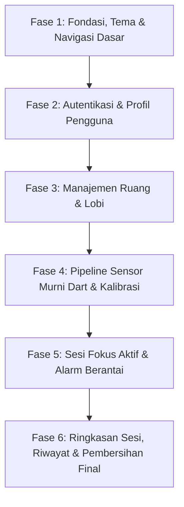

# Audit Repositori Kerkom (Focus App) & Rencana Transisi Arsitektur

> **Dokumen Audit Teknis & Pemetaan Arsitektur**  
> Tanggal: 12 Oktober 2026  
> Target: Rebuild Aplikasi "Kerkom" (Flutter + Dart, Firebase Auth + Realtime Database, sensors_plus)  
> Status Operasi: **Read-Only Audit (Tidak ada perubahan kode produksi pada fase ini)**

---

## 1. Struktur Folder Saat Ini & State Management

### A. Struktur Folder Eksisting
Struktur saat ini menggunakan pendekatan *layer-by-type* yang tercampur dan belum mengadopsi arsitektur *feature-first*:

```
lib/
├── main.dart                          # Inisialisasi Firebase & root widget MaterialApp
├── models/
│   └── room_model.dart                # Model StudyRoom, Member, MemberStatus, RoomAlert
├── services/
│   ├── backend_service.dart           # Service legacy (Firestore + Cloud Functions - tidak terpakai)
│   ├── firebase_service.dart          # Service Firebase Realtime Database & Auth (singleton)
│   ├── room_service.dart              # State & logika ruangan berbasis ChangeNotifier (singleton)
│   └── sensor_service.dart            # Service sensor PhoneMotionService (singleton)
├── screens/
│   ├── active_session_screen.dart     # Layar sesi aktif & telemetri sensor
│   ├── beranda_screen.dart            # Layar beranda (terdapat gamifikasi & hardcode)
│   ├── home_screen.dart               # Shell navigasi (BottomNavigationBar 4 tab)
│   ├── incident_screen.dart           # Layar pelanggaran/alarm (hardcode Dimas Arya)
│   ├── late_joiner_screen.dart        # Layar late joiner & travel mode
│   ├── profil_screen.dart             # Layar profil pengguna
│   ├── riwayat_log_screen.dart        # Layar ringkasan & riwayat log
│   ├── ruang_sesi_screen.dart         # Layar lobi/sesi belajar
│   ├── study_room_screen.dart         # Wrapper usang ke ActiveSessionScreen
│   └── kerkom_focus_app_design_system/# 19 Layar Desain Sistem Stitch (S01 - S19) + DESIGN.md
├── theme/
│   └── app_theme.dart                 # Token tema lama (Light mode Tailwind emerald/indigo)
└── widgets/
    ├── app_avatar.dart                # Komponen avatar dengan badge
    └── studypact_app_bar.dart         # Custom AppBar StudyPact
```

### B. Evaluasi State Management Saat Ini
- **State Management Eksisting:** Campuran antara `setState()` lokal, singleton class dengan `ChangeNotifier` (`RoomService`), serta `StreamSubscription` manual yang tersebar langsung di dalam widget `StatefulWidget`.
- **Kelemahan Arsitektur Saat Ini:**
  - Logic bercampur aduk dengan UI (misalnya kalkulasi pitch/roll, timer `Timer.periodic`, dan navigasi dijalankan langsung di dalam `build()` atau `initState()`).
  - Kurang modularitas dan sulit diuji via *unit test*.
  - Terjadi potensi *memory leak* jika `StreamSubscription` atau `Timer` lupa di-cancel saat dispose.
- **Rencana Transisi ke Global Rule 5:**
  - Migrasi total ke **Riverpod (`flutter_riverpod`)** untuk state management yang reaktif, aman terhadap *lifecycle*, dan dapat di-test.
  - Mengubah struktur folder menjadi *feature-first*:
    ```
    lib/
    ├── core/
    │   ├── constants/
    │   ├── theme/                     # app_theme.dart (desain token Kerkom Dark Focus System)
    │   ├── router/                    # go_router configuration
    │   └── utils/
    └── features/
        ├── auth/ {data, domain, presentation}
        ├── room/ {data, domain, presentation}
        ├── sensor/ {data, domain, presentation} # Sensor logic pure Dart terpisah dari Flutter UI
        ├── session/ {data, domain, presentation}
        └── profile/ {data, domain, presentation}
    ```

---

## 2. Pemetaan Seluruh Layar & Rute (Eksisting vs S01–S19)

Navigasi saat ini menggunakan navigasi imperatif `Navigator.push(MaterialPageRoute(...))` dan `IndexedStack` di `HomeScreen`. Di bawah ini adalah pemetaan komprehensif seluruh layar yang ada terhadap spesifikasi S01–S19:

| Kode | Nama Layar Spesifikasi | Layar Eksisting | Status Rekomendasi | Catatan Perubahan & Penyesuaian |
| :--- | :--- | :--- | :--- | :--- |
| **S01** | Splash | *Belum ada* | **CREATE / NEW** | Buat layar splash baru dengan logo "Kerkom", progress bar, dan slogan *"Kerja kelompok tanpa distraksi"*. |
| **S02** | Masuk | *Belum ada* | **CREATE / NEW** | Buat layar login email/password & Google Sign-In terhubung ke Firebase Auth resmi. |
| **S03** | Lengkapi Profil | *Sebagian di dialog profil* | **CREATE / NEW** | Formulir inisialisasi nama pengguna pasca pendaftaran pertama kali. |
| **S04** | Beranda Mobile | `lib/screens/beranda_screen.dart` | **REWRITE** | Tulis ulang total: Hapus seluruh gamifikasi (XP, streak, level, kalender, daftar teman). Gunakan token *Kerkom Dark Focus System*. |
| **S05** | Sheet Buat Ruang | `home_screen.dart` (bottom sheet) | **REWRITE** | Pisahkan menjadi modal bottom sheet terisolasi dengan input judul & pilihan durasi menit murni. |
| **S06** | Sheet Gabung Kode | `home_screen.dart` (dialog) | **REWRITE** | Format input kode ruang huruf kapital (6 digit / format PACT-XXXX) dengan validasi RTDB. |
| **S07** | Lobi Ruang | `lib/screens/ruang_sesi_screen.dart` | **REWRITE** | Tampilkan daftar peserta real-time, status host, tombol copy/share kode, dan tombol "Mulai Sesi Bersama". |
| **S08** | Kalibrasi | Dialog di `ruang_sesi_screen.dart` & `late_joiner_screen.dart` | **REWRITE** | Layar persiapan peletakan HP di meja datar, hitung mundur stabil 3 detik, penangkapan baseline vektor gravitasi. |
| **S09** | Sesi Aktif | `lib/screens/active_session_screen.dart` | **REWRITE** | Desain Dark Focus (`#0F1115`), timer angka tabular (`Nunito Sans 900`), status kartu peserta, sensor live, tombol geser selesai/keluar. |
| **S10** | Alarm Pelanggar | `lib/screens/incident_screen.dart` | **REWRITE** | Khusus untuk orang yang mengangkat HP: Layar darurat merah berdenyut, peringatan instan, countdown 10 detik batal/kembalikan ke meja. |
| **S11** | Alarm Anggota Lain | *Hanya SnackBar di active_session* | **CREATE / NEW** | Layar/banner darurat bagi seluruh anggota tim ketika ada rekan (UID & nama asli) yang mengangkat HP. |
| **S12** | Ringkasan Sesi | Sebagian di `riwayat_log_screen.dart` | **REWRITE** | Statistik pasca sesi murni: durasi fokus aktual, jumlah pelanggaran, daftar anggota tim (tanpa XP/poin). |
| **S13** | Riwayat | `lib/screens/riwayat_log_screen.dart` | **REWRITE** | Daftar riwayat sesi fokus lampau dari node `/session_logs/$uid` (tanpa reward XP/gamifikasi). |
| **S14** | Profil | `lib/screens/profil_screen.dart` | **REWRITE** | Tampilan profil pengguna (nama, email dari Firebase Auth), tombol edit, opsi sensitivitas, logout. |
| **S15** | Edit Profil | Dialog di `profil_screen.dart` | **REWRITE** | Layar form pengubahan nama tampilan pengguna di Firebase RTDB. |
| **S16** | Sensitivitas Sensor | Dialog di `home_screen.dart` | **REWRITE** | Layar pengaturan toleransi sensor (Rendah, Sedang, Tinggi) dengan visualisasi uji kemiringan langsung. |
| **S17** | Pengaturan Alarm | *Belum ada* | **CREATE / NEW** | Pengaturan preferensi alarm lokal: jenis notifikasi, getaran, audio, durasi grace period. |
| **S18** | Daftar | *Belum ada* | **CREATE / NEW** | Layar registrasi akun baru (email, password, konfirmasi password). |
| **S19** | Sheet Izin Pemantauan| *Belum ada* | **CREATE / NEW** | Bottom sheet edukasi izin sensor & latar belakang saat sesi berlangsung. |
| **-** | Layar Lama Usang | `lib/screens/study_room_screen.dart` | **DELETE** | Berkas wrapper duplikat yang tidak lagi digunakan. |
| **-** | Layar Late Joiner | `lib/screens/late_joiner_screen.dart` | **DELETE** | Dihapus karena memuat fitur di luar MVP (*Travel Mode*) dan flow bergabung sudah terpusat di S06 -> S07/S08. |

---

## 3. Analisis Logika Sensor Saat Ini & Masalah Pengangkatan Lambat (Slow Lift)

### A. Kode Sensor Saat Ini (`lib/services/sensor_service.dart`)
```dart
// 1. Event hanya dipicu dari UserAccelerometer
_motion = userAccelerometerEventStream(samplingPeriod: SensorInterval.gameInterval)
    .listen((event) => _process(event.x, event.y, event.z));

// 2. Logika deteksi gerak
void _process(double x, double y, double z) {
  final magnitude = sqrt(x * x + y * y + z * z);
  final angle = orientationChangeDeg;
  final moving = angle >= 25 || (magnitude >= sensitivity.threshold && _gyroMagnitude >= .35);
  // ...
  if (!_lifted && now.difference(_candidateAt!).inMilliseconds >= 650) { ... }
}
```

### B. Mengapa Pengangkatan Perlahan (Slow Phone Lift) Gagal Terdeteksi?
1. **Besaran Magnitudo Akselerasi Baku (Raw Acceleration Magnitude) Konstan Terhadap Kemiringan:**
   - Hukum fisika sensor: Saat ponsel diam di meja datar, akselerometer membaca vektor gravitasi bumi $\vec{g} = [0, 0, 9.8]\text{ m/s}^2$, dengan magnitudo $\|\vec{g}\| = \sqrt{0^2 + 0^2 + 9.8^2} \approx 9.8\text{ m/s}^2$ ($1g$).
   - Ketika ponsel diangkat miring secara perlahan (misal pitch 30°), komponen vektor berubah menjadi $[4.9, 0, 8.49]\text{ m/s}^2$. Namun, magnitudo totalnya:
     $$\sqrt{4.9^2 + 0^2 + 8.49^2} = \sqrt{24.01 + 72.08} = \sqrt{96.09} \approx 9.8\text{ m/s}^2$$
   - **Magnitudo Euclidean tidak berubah sama sekali akibat kemiringan/tilt.** Jika algoritma hanya mengawasi lonjakan magnitudo akselerasi (`magnitude >= threshold`), gerakan perlahan tidak akan pernah terdeteksi.
2. **Kelemahan `UserAccelerometerEvent` pada Gerakan Lambat:**
   - `UserAccelerometer` menghitung percepatan linier dinamis tanpa gravitasi ($a_{linier} = a_{total} - g$).
   - Pada gerakan mengangkat ponsel yang sangat perlahan dan stabil (kecepatan konstan), percepatan linier bernilai mendekati nol ($a \approx 0$). Akibatnya, `magnitude` tidak pernah menembus ambang batas (1.2 – 3.5 m/s²).
3. **Penyimpangan Baseline pada Masa Kalibrasi:**
   - Dalam `sensor_service.dart`, vektor baseline terus di-update otomatis selama 2 detik pertama (`_bx = .95 * _bx + .05 * _gx`). Jika pengguna mulai mengangkat ponsel secara bertahap sejak awal, baseline gravitasi ikut bergeser mengikuti posisi baru ponsel.
4. **Ambang Batas Sudut Terlalu Tinggi & Syarat Waktu 650 ms:**
   - Syarat `angle >= 25°` terlalu longgar. Banyak pengguna mengangkat ponsel dan melihat layar pada sudut kemiringan 12° – 20°.
   - Syarat `now.difference(_candidateAt!).inMilliseconds >= 650` akan ter-reset jika akselerasi sempat turun di bawah ambang batas selama pecahan detik.

### C. Solusi Pipeline Sensor Pure Dart yang Benar
1. **Separasi Penuh:** Buat class logika sensor murni Dart (`SensorPipeline`) tanpa ketergantungan Flutter UI agar dapat diuji secara unit test (100% testable).
2. **Deteksi Deviasi Vektor Gravitasi (Orientation Cosine Angle):**
   - Tangkap baseline gravitasi meja $\vec{b} = [b_x, b_y, b_z]$ saat kalibrasi selesai (bekukan nilai, jangan di-update terus-menerus).
   - Hitung deviasi sudut secara kontinu dari `accelerometerEventStream`:
     $$\theta = \arccos\left(\frac{\vec{g} \cdot \vec{b}}{\|\vec{g}\| \|\vec{b}\|}\right) \times \frac{180}{\pi}$$
   - Jika $\theta > \text{threshold}$ (misal 15° pada sensitivitas standar), ponsel langsung dinyatakan terangkat terlepas dari seberapa lambat gerakan mengangkatnya.
3. **Fusi Gyroscope + Pitch/Roll Low-Pass Filter:**
   - Gunakan integrasi gyro untuk mendeteksi rotasi dinamis seketika, dan gunakan gravitasi mutlak untuk mendeteksi perubahan statis posisi ponsel.

---

## 4. Inventarisasi Data Dummy & Nilai Hardcoded Saat Ini

Berdasarkan audit menyeluruh, berikut adalah seluruh lokasi data dummy, hardcoded, dan fitur non-MVP yang harus dihilangkan total sesuai **Global Rules 2 & 3**:

| Lokasi Berkas | Baris Kode / Elemen | Data Dummy / Hardcoded / Non-MVP | Tindakan |
| :--- | :--- | :--- | :--- |
| `lib/services/room_service.dart` | Baris 24, 60 | Default nama `'Mahasiswa'`, Level 1, XP 0, Streak 1 | Ambil nama & UID asli dari Firebase Auth |
| `lib/services/room_service.dart` | Baris 134, 195 | URL Avatar Unsplash hardcoded | Hapus avatar dummy; gunakan inisial nama |
| `lib/services/room_service.dart` | Baris 127 | Format `'PACT-${Random().nextInt(...)}'` | Standarkan kode ruang dan simpan di RTDB |
| `lib/services/firebase_service.dart` | Baris 20 | Fallback `'user-local'` | Wajibkan Auth valid sebelum operasi database |
| `lib/services/firebase_service.dart` | Baris 159–177 | Kalkulasi XP, Level, Streak di log | Hapus seluruh akumulasi gamifikasi |
| `lib/screens/beranda_screen.dart` | Seluruh berkas | Level progress card (Level 14, 840 XP, 7 streak) | Hapus total (gamifikasi dilarang) |
| `lib/screens/beranda_screen.dart` | `_buildInvitationCard` | Undangan dari "Sarah Amalia", room "PACT-8821" | Hapus total (dummy hardcoded) |
| `lib/screens/beranda_screen.dart` | `_buildCalendarCard` | Kalender fokus (fitur kalender dilarang) | Hapus total |
| `lib/screens/beranda_screen.dart` | `_buildActiveFriendsSection` | Daftar teman (Sarah, Budi, Nabila) | Hapus total (fitur teman dilarang) |
| `lib/screens/beranda_screen.dart` | Baris 104 | Penggunaan emoji `👋` | Hapus semua emoji (aturan desain tegas) |
| `lib/screens/incident_screen.dart` | Seluruh berkas | Nama "Dimas Arya", penalti "-50 XP", Unsplash URL | Tulis ulang menjadi S10 (pelanggar) & S11 (rekan) berbasis data live Firebase |
| `lib/screens/active_session_screen.dart` | Baris 150, 470 | Banner "+34 XP Terkumpul", bonus teamwork | Hapus total indikator XP |
| `lib/screens/active_session_screen.dart` | Baris 517 | Fallback anggota dummy jika null | Tampilkan hanya anggota riil dari RTDB |
| `lib/screens/riwayat_log_screen.dart` | Seluruh berkas | Papan peringkat (leaderboard), XP, nama dummy | Tampilkan riwayat sesi murni tanpa leaderboard |
| `lib/screens/profil_screen.dart` | Baris 158–178 | Level, XP, Streak, emoji 🔥⚡🛡 | Bersihkan profil dari gamifikasi |
| `lib/screens/late_joiner_screen.dart` | Baris 18 | `bool _travelMode = false;` | Hapus (Travel Mode dilarang) |
| `lib/main.dart` | Baris 47 | Judul app `'StudyPact - Focus & ...'` | Ganti menjadi `'Kerkom'` di seluruh level |

---

## 5. Penggunaan Firebase Saat Ini (Auth, RTDB, Security Rules)

### A. Metode Autentikasi (Firebase Auth)
- **Saat ini:** Hanya memanggil `signInAnonymously()` di background saat service diinisialisasi.
- **Kebutuhan S02/S18/S03:** 
  - Login & Registrasi via Email & Password (`signInWithEmailAndPassword`, `createUserWithEmailAndPassword`).
  - Login via Google (`GoogleAuthProvider`).
  - Pembaruan nama profil pengguna (`user.updateDisplayName`).

### B. Jalur Database (Realtime Database Paths)
URL Database resmi: `https://kerkom-project-default-rtdb.asia-southeast1.firebasedatabase.app/`
Struktur node aktif saat ini:
1. `/users/$uid`:
   - Menyimpan: `id`, `name`, `lastActive`, `level`, `xp`, `streakDays`.
   - *Penyesuaian:* Hapus node `level`, `xp`, `streakDays`. Simpan hanya identitas pengguna (`id`, `name`, `email`, `lastActive`).
2. `/rooms/$roomCode`:
   - Menyimpan: `id`, `code`, `title`, `leaderId`, `leaderName`, `durationMinutes`, `remainingSeconds`, `isSessionActive`, `createdAt`, `sessionStartedAt`.
3. `/rooms/$roomCode/members/$memberId`:
   - Menyimpan: `id`, `name`, `isLeader`, `status` (`focusing` / `phoneLifted`), `distractionCount`, `pitch`, `roll`, `vibration`, `lastUpdated`, `lastDistractionTime`.
4. `/rooms/$roomCode/alerts/$alertId`:
   - Menyimpan: `id`, `memberId`, `memberName`, `message`, `timestamp`.
   - *Catatan Kritis:* Wajib memuat `memberId` (UID riil) orang yang melanggar agar layar S10 dan S11 dapat membedakan secara instan apakah perangkat sendiri atau perangkat rekan yang melanggar.
5. `/session_logs/$uid/$logId`:
   - Menyimpan riwayat sesi per pengguna: `id`, `roomCode`, `title`, `durationMinutes`, `distractionCount`, `completedAt`.

### C. Security Rules (`database.rules.json`)
Aturan saat ini telah mengizinkan akses terstruktur pada `/users/$uid`, `/rooms/$roomCode`, dan `/session_logs/$uid`. Aturan ini aman dipertahankan tanpa modifikasi sesuai **Global Rule 1**.

### D. File Legacy Tidak Terpakai
- `lib/services/backend_service.dart` memanggil Firestore dan Cloud Functions yang tidak digunakan oleh arsitektur RTDB dan harus dipensiunkan.

---

## 6. Audit Paket Dependensi (`pubspec.yaml`)

```yaml
# EVALUASI PAKET PUBSPEC.YAML
```

### A. Paket yang Dipertahankan (KEEP)
- `sensors_plus: ^7.1.0` — Akses sensor akselerometer & giroskop (inti aplikasi).
- `firebase_core: ^4.15.0` — Fondasi Firebase.
- `firebase_auth: ^6.7.0` — Autentikasi pengguna nyata.
- `firebase_database: ^12.6.0` — Sinkronisasi real-time antar perangkat.
- `share_plus: ^13.3.0` — Berbagi kode ruang ke media lain.
- `uuid: ^4.6.0` — Pembuatan ID unik sesi dan episode.
- `intl: ^0.20.3` — Pemformatan tanggal, waktu, dan angka dalam Bahasa Indonesia.
- `cupertino_icons: ^1.0.8` — Ikon pendukung.

### B. Paket yang Ditambahkan (ADD) Sesuai Global Rules
- `flutter_riverpod: ^2.6.1` — **Wajib (Global Rule 5)** untuk state management reaktif yang modular dan testable.
- `go_router: ^14.8.1` — **Wajib (Global Rule 5 & 6)** untuk routing deklaratif yang memetakan Tabel Navigasi Master secara presisi.
- `google_fonts: ^6.2.1` — Untuk memuat font resmi **Nunito Sans** sesuai desain token spec `DESIGN.md`.

### C. Paket yang Dihapus / Dipensiunkan (REMOVE)
- `cloud_firestore: ^6.10.0` — Dihapus dari kode aktif (aplikasi murni RTDB).
- `cloud_functions: ^6.5.0` — Dihapus dari kode aktif (tidak ada Cloud Functions pada MVP).
- `firebase_messaging: ^16.7.0` — Tidak diperlukan pada MVP karena sinkronisasi alarm berbasis RTDB stream.

---

## 7. Rencana Urutan Fase Pengerjaan & Analisis Risiko

Sesuai **Global Rule 7**, pengerjaan akan dibagi menjadi fase terstruktur. Setiap fase akan diawali dengan rencana detail (*plan output*), menunggu persetujuan pengguna, implementasi, validasi `flutter analyze` & `flutter test`, serta ringkasan instruksi uji coba pada ponsel riil.

### A. Urutan Fase Kerja yang Diusulkan



1. **Fase 1: Fondasi, Desain Sistem & Routing Dasar**
   - Pembaruan dependensi `pubspec.yaml` (tambah `flutter_riverpod`, `go_router`, `google_fonts`).
   - Implementasi tema sentral `lib/core/theme/app_theme.dart` berbasis token eksak `DESIGN.md` (Obsidian `#0F1115`, Acid Lime `#C6F432`, Nunito Sans, tabular-nums, tanpa emoji).
   - Setup kerangka folder *feature-first* dan konfigurasi awal `go_router`.
   - Mengubah nama aplikasi menjadi "Kerkom" di kode, Android label (`AndroidManifest.xml`), dan konfigurasi terkait.

2. **Fase 2: Fitur Autentikasi & Profil (S01, S02, S18, S03, S14, S15)**
   - Implementasi S01 (Splash).
   - Implementasi S02 (Masuk), S18 (Daftar), dan S03 (Lengkapi Profil) terhubung ke Firebase Auth.
   - Implementasi S14 (Profil) dan S15 (Edit Profil) yang membaca data riil dari RTDB `/users/$uid`.
   - Menghapus total seluruh konsep level, streak, dan XP.

3. **Fase 3: Fitur Beranda, Pembuatan Ruang & Lobi (S04, S05, S06, S07)**
   - Implementasi S04 (Beranda) bebas gamifikasi, menampilkan ringkasan ruang aktif dan riwayat terkini.
   - Implementasi S05 (Sheet Buat Ruang) & S06 (Sheet Gabung Kode).
   - Implementasi S07 (Lobi Ruang) dengan daftar peserta live di `/rooms/$roomCode/members`.

4. **Fase 4: Pipeline Sensor Murni Dart, Kalibrasi & Sensitivitas (S08, S16, S19)**
   - Membangun class pure Dart `SensorPipeline` (terpisah total dari Flutter UI, unit-testable).
   - Implementasi algoritma deteksi sudut vektor gravitasi $\arccos(\vec{g} \cdot \vec{b})$ untuk menjamin pengangkatan perlahan (*slow lift*) pasti terdeteksi.
   - Implementasi S08 (Kalibrasi 3 detik), S16 (Sensitivitas), dan S19 (Sheet Izin Pemantauan).

5. **Fase 5: Sesi Fokus Aktif & Sistem Alarm Real-Time (S09, S10, S11)**
   - Implementasi S09 (Sesi Aktif) dengan countdown timer tabular, live telemetry, dan slide to exit.
   - Implementasi S10 (Alarm Pelanggar dengan grace period 10 detik batal sebelum lapor ke grup).
   - Implementasi S11 (Alarm Anggota Lain saat ada rekan yang melanggar di RTDB `/rooms/$roomCode/alerts`).

6. **Fase 6: Ringkasan Sesi, Riwayat & Audit Akhir (S12, S13, Pembersihan)**
   - Implementasi S12 (Ringkasan Sesi) dan S13 (Riwayat) berbasis `/session_logs/$uid`.
   - Menghapus seluruh file lama (`backend_service.dart`, `study_room_screen.dart`, `incident_screen.dart`, `late_joiner_screen.dart`, dll).
   - Verifikasi total: `flutter analyze` 0 error, `flutter test` lulus, dan verifikasi tidak ada data dummy tersisa di seluruh codebase.

---

### B. Analisis Risiko & Strategi Mitigasi

| Risiko Potensial | Dampak Teknis | Strategi Mitigasi |
| :--- | :--- | :--- |
| **Noise Sensor pada Ragam Ponsel Fisik** | HP bergetar atau sensor drift menyebabkan alarm palsu (*false positive*). | Terapkan filter low-pass pada pembacaan akselerometer dan tambahkan *deadband tolerance* (misal 5° noise threshold) sebelum memicu candidate event. |
| **Layar Mati / Doze Mode Android** | Stream sensor berhenti berjalan saat ponsel ditaruh di meja dan layar mati (*screen timeout*). | Gunakan `wakelock_plus` atau konfigurasi flag layar tetap aktif redup (*dimmed focus mode*) selama sesi fokus berlangsung. |
| **Konektivitas RTDB Terputus (Network Drops)** | Sesi gagal sinkronisasi antar peserta di perpustakaan/kampus. | Aktifkan `setPersistenceEnabled(true)` dan gunakan listener `onDisconnect()` di Firebase untuk menangani status presensi peserta secara anggun (*graceful*). |
| **Migrasi State Management ke Riverpod** | Risiko refactor massal menyebabkan regresi logika. | Lakukan isolasi per fitur secara bertahap sesuai urutan fase; tidak merombak fitur lain sebelum fitur berjalan stabil. |
| **Ketepatan Tabel Navigasi Master** | Alur perpindahan layar membingungkan antara host dan peserta. | Terapkan redirect guards pada `go_router` yang merujuk secara ketat pada kondisi status ruangan (`isSessionActive`, `status`, `leaderId`). |

---

*Dokumen audit ini telah selesai disusun untuk menjadi acuan implementasi bertahap pada fase berikutnya.*
